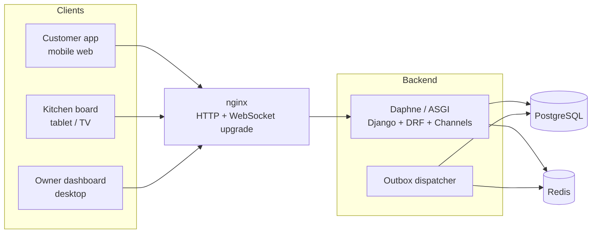
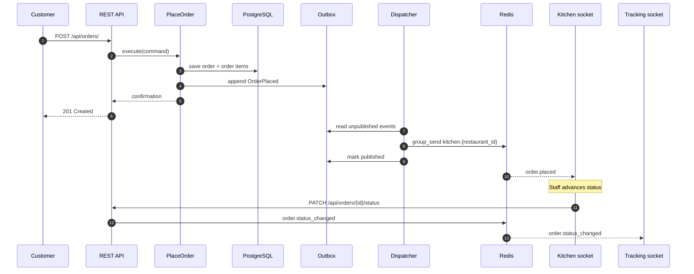
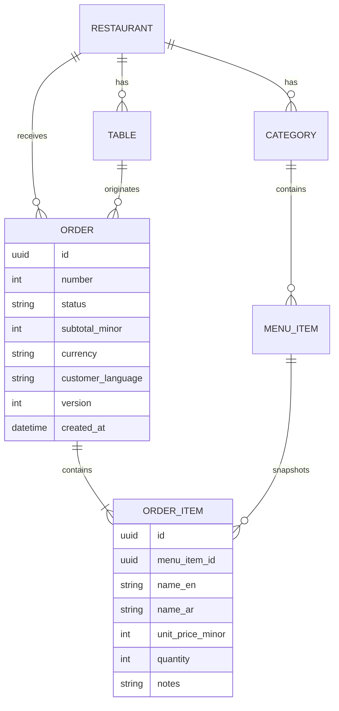

# Tawla — QR Ordering with a Live Kitchen Display

**Tawla** (طاولة, "table") is a bilingual, real-time restaurant ordering platform. Customers scan a
QR code at their table, browse the menu, place an order, and follow its progress live. Kitchen staff
see new orders instantly on a high-contrast board, and owners manage the menu and sales from a
dashboard.

Built as a portfolio-grade Django Channels and React project, Tawla demonstrates clean architecture,
websockets, Redis fan-out, PostgreSQL persistence, Docker, nginx WebSocket proxying, CI/CD, full
Arabic/English support, and accessibility.

> Status: MVP in active development. The sections below describe the target system and its contracts;
> commands and paths reflect the planned repository layout.

---

## Table of Contents

- [Why Tawla](#why-tawla)
- [Features](#features)
- [Architecture](#architecture)
- [Tech Stack](#tech-stack)
- [Repository Layout](#repository-layout)
- [Quick Start](#quick-start)
- [Local Development](#local-development)
- [Using the App](#using-the-app)
- [API Overview](#api-overview)
- [WebSocket Contract](#websocket-contract)
- [Internationalization](#internationalization)
- [Design System](#design-system)
- [Testing](#testing)
- [Quality Gates](#quality-gates)
- [Deployment](#deployment)
- [Design Decisions](#design-decisions)
- [Troubleshooting](#troubleshooting)
- [Roadmap](#roadmap)
- [License](#license)

---

## Why Tawla

Restaurants and cafes need digital menus, faster ordering, and fewer mistakes between the floor and
the kitchen. Tawla focuses on the moment that matters: an order placed on a phone appears on the
kitchen screen immediately, and the customer sees every status change without refreshing.

The project is intentionally shaped like a real product, not a demo:

- A **domain model** that enforces valid order transitions instead of trusting the UI.
- **Ports and adapters** so business rules are testable without Django, Redis, or a database.
- **Language-neutral real-time events** so an Arabic kitchen and an English customer see the same
  order correctly.
- **Operational concerns** such as health checks, an outbox, reconnect/resync, and a deploy smoke test.

---

## Features

### Customer

- Scan a table QR code and open the correct menu.
- Browse categories, item photos, descriptions, prices, and sold-out badges.
- Add items with quantity and notes through a mobile bottom sheet.
- Review a persistent cart with live totals.
- Place an order with duplicate-submission protection.
- Track status live: Received → Preparing → Ready → Served.
- Switch between Arabic (RTL) and English (LTR) without losing the cart or socket.

### Kitchen

- Live board with New, Preparing, and Ready columns.
- New orders arrive instantly with a highlight and optional sound.
- One-tap status changes with optimistic updates and rollback on failure.
- Large, high-contrast cards readable from a distance.
- Connection indicator with automatic reconnect and full resync.

### Owner

- Create and edit categories and menu items in both languages.
- Toggle item availability; customers see the change in real time.
- Manage tables and print QR codes.
- View daily sales, top items, average ticket, and average preparation time.

### Platform

- Django 5, DRF, Django Channels, Redis channel layer, PostgreSQL.
- React + TypeScript + Vite, TanStack Query, Zustand, react-i18next.
- Docker Compose for local and production-shaped environments.
- nginx HTTP and WebSocket proxying.
- GitHub Actions lint, test, build, deploy, and post-deploy WebSocket smoke test.
- EN/AR, RTL, WCAG 2.1 AA, reduced-motion support.

---

## Architecture

### System context



### Layered design

Tawla is a **modular monolith** with hexagonal boundaries. Each bounded context contains four layers:

```text
presentation/   DRF views, serializers, Channels consumers (thin adapters)
application/    use cases, commands, queries, ports, DTOs
domain/         entities, value objects, state machine, events, domain errors
infrastructure/ Django models, repositories, event publishers, QR generator
container.py    composition root
```

The dependency rule points inward:

```text
presentation ──> application ──> domain
                       ^
                       │
               infrastructure (implements ports)
```

- `domain` imports only the Python standard library.
- `application` defines interfaces and orchestrates use cases.
- `infrastructure` implements those interfaces with Django, Redis, and Channels.
- `presentation` translates HTTP and WebSocket messages into use-case calls.
- `container.py` is the only place that knows concrete classes.

`import-linter` enforces these boundaries in CI.

### Order placement event flow



Events are published **after** the transaction commits through a transactional outbox. This prevents
notifying the kitchen about an order that later rolls back and lets the dispatcher retry if Redis is
temporarily unavailable.

### Bounded contexts

| Context | Responsibility |
|---|---|
| `accounts` | Staff users, roles, authentication, preferred language |
| `menu` | Restaurants, tables, categories, items, availability, QR codes |
| `ordering` | Orders, order items, state machine, kitchen and tracking read models |
| `analytics` | Sales aggregates and reporting |
| `realtime` | WebSocket consumers, channel groups, tickets, dispatch |

### Domain model



Order items store a **snapshot** of both language names and the unit price at order time. Editing the
menu later never changes historical orders or receipts.

### Order state machine

```text
RECEIVED ──> PREPARING ──> READY ──> SERVED
    │
    └──> CANCELLED
```

- `CANCELLED` is allowed only from `RECEIVED`.
- `SERVED` and `CANCELLED` are terminal.
- Every other transition raises `InvalidTransition`.
- Transitions are defined in one table, not scattered across views or consumers.

### SOLID in one glance

| Principle | Where it shows up |
|---|---|
| Single Responsibility | `Order` owns transitions; `PriceCalculator` owns totals; consumers translate messages |
| Open/Closed | New statuses via the transition table; new events via `DomainEvent` subclasses; new languages via config and files |
| Liskov Substitution | `ChannelsEventPublisher` and `InMemoryEventPublisher` are interchangeable |
| Interface Segregation | Separate `OrderReader` and `OrderWriter`; the kitchen only needs the reader |
| Dependency Inversion | Use cases depend on ports, never on Django, Channels, or Redis |

### Real-time design

| Group | Members | Events |
|---|---|---|
| `kitchen.{restaurant_id}` | Kitchen sockets | `order.placed`, `order.status_changed` |
| `order.{order_id}` | Customer tracking socket | `order.status_changed` |
| `menu.{restaurant_id}` | Customer menu sockets | `menu.item_availability_changed` |
| `dashboard.{restaurant_id}` | Owner dashboard | `order.placed`, `order.status_changed` |

Sockets authenticate with a **short-lived signed ticket** obtained over REST. Tickets carry explicit
scopes and subject ids, so a customer can never join a kitchen group and one restaurant can never see
another's orders. Long-lived JWTs are not placed in WebSocket URLs.

Clients reconnect with exponential backoff and jitter, send heartbeats, and refetch full state after
reconnecting. Events carry `event_id` and `order_version` so duplicate or stale messages are ignored.

---

## Tech Stack

| Layer | Technology |
|---|---|
| Backend | Python 3.12, Django 5, Django REST Framework |
| Real-time | Django Channels, Daphne, Redis channel layer |
| Database | PostgreSQL |
| Frontend | React, TypeScript, Vite |
| Server state | TanStack Query |
| Client state | Zustand |
| Routing | React Router |
| Styling | Tailwind CSS, shadcn/ui, Radix primitives |
| i18n | react-i18next, Django i18n, `Intl` formatters |
| Infra | Docker Compose, nginx, GitHub Actions |
| Backend quality | ruff, mypy, pytest, pytest-asyncio, `channels.testing`, import-linter |
| Frontend quality | ESLint, TypeScript, Vitest, Testing Library, MSW, Playwright, axe-core |

---

## Repository Layout

```text
tawla-live-orders/
├── backend/
│   ├── config/                  # Django settings, ASGI, root URLs and routing
│   ├── tawla/
│   │   ├── shared/              # Money, LocalizedText, events, ports, outbox
│   │   ├── accounts/            # staff auth and preferences
│   │   ├── menu/                # restaurants, tables, categories, items, QR
│   │   ├── ordering/            # Order aggregate, use cases, kitchen/tracking
│   │   ├── analytics/           # sales read models
│   │   ├── realtime/            # consumers, tickets, routing
│   │   └── container.py         # composition root
│   └── tests/
│       ├── unit/                # pure domain tests
│       ├── application/         # use cases with fakes
│       ├── integration/         # API, persistence, consumers
│       ├── contract/            # event schemas
│       └── e2e/
├── frontend/
│   ├── src/
│   │   ├── app/                 # providers, router, config
│   │   ├── shared/              # api, realtime, i18n, ui, lib
│   │   └── features/            # menu, cart, orders, tracking, kitchen, owner
│   └── playwright/
├── deploy/
│   ├── nginx/                   # HTTP and WebSocket proxy config
│   ├── docker/                  # Dockerfiles and entrypoint
│   └── compose/                 # dev and production Compose files
├── docs/
│   ├── architecture/            # diagrams and ADRs
│   └── design/                  # wireframes and tokens
├── scripts/                     # seed, smoke test, i18n check
├── .github/workflows/           # CI and deploy pipelines
├── Makefile
└── README.md
```

---

## Quick Start

### Prerequisites

- Docker Desktop or Docker Engine with Compose v2
- Make (optional but recommended)
- Node.js 20+ and Python 3.12+ only if running services outside Docker

### One command

```bash
cp deploy/compose/.env.example .env
make up
```

Then open:

| URL | Purpose |
|---|---|
| `http://localhost:8080/menu?table=<token>` | Customer menu |
| `http://localhost:8080/kitchen` | Kitchen board |
| `http://localhost:8080/owner` | Owner dashboard |
| `http://localhost:8080/health` | Health check |

Load demo data and copy a table token:

```bash
make migrate
make seed
```

The seed prints a sample table URL and creates staff accounts documented in the command output.

### Without Make

```bash
docker compose -f deploy/compose/docker-compose.yml up --build -d
docker compose -f deploy/compose/docker-compose.yml exec backend python manage.py migrate
docker compose -f deploy/compose/docker-compose.yml exec backend python manage.py seed_demo
```

---

## Local Development

### Backend

```bash
cd backend
python -m venv .venv
source .venv/bin/activate
pip install -e ".[dev]"
cp ../deploy/compose/.env.example ../.env
python manage.py migrate
python manage.py seed_demo
python manage.py runserver          # or: daphne config.asgi:application
```

### Frontend

```bash
cd frontend
npm install
npm run dev
```

The Vite dev server proxies `/api` and `/ws` to the backend. Set `VITE_API_BASE_URL` and
`VITE_WS_BASE_URL` if you run services on different ports.

### Outbox dispatcher

```bash
cd backend
python manage.py dispatch_outbox --watch
```

### Common commands

| Command | Purpose |
|---|---|
| `make up` | Start the development stack |
| `make down` | Stop the stack |
| `make migrate` | Apply migrations |
| `make seed` | Load demo restaurant, tables, menu, and staff |
| `make test` | Run backend and frontend tests |
| `make lint` | Ruff, mypy, import-linter, ESLint, TypeScript |
| `make e2e` | Run Playwright end-to-end tests |
| `make i18n-check` | Compare EN/AR translation keys |
| `make smoke` | WebSocket smoke test against a deployment |

---

## Using the App

### Customer flow

1. Scan the table QR code or open `/menu?table=<token>&lang=ar`.
2. Browse categories; sold-out items are labeled and disabled.
3. Tap an item, choose quantity, add a note, and add it to the cart.
4. Open the cart and review totals.
5. Place the order. The confirmation appears only after the server confirms it.
6. The tracking page shows Received → Preparing → Ready → Served with live updates.
7. Switch language at any time; the cart and socket stay intact.

### Kitchen flow

1. Sign in at `/kitchen` with a staff account.
2. New orders appear in the New column with a highlight and optional sound.
3. Tap **Start** to move an order to Preparing, then **Ready**, then **Served**.
4. The connection indicator shows Live, Reconnecting, or Offline. On reconnect the board refetches
   the full state before applying new events.

### Owner flow

1. Sign in at `/owner`.
2. Manage categories and items in English and Arabic.
3. Toggle availability; customer menus update through the `menu.{restaurant_id}` group.
4. Open Tables to download or print QR codes.
5. Open Sales to view revenue, order count, top items, average ticket, and average preparation time.

---

## API Overview

All endpoints are under `/api`. Errors return a stable machine `code` and a translated `detail`.

### Public and customer

| Method | Endpoint | Purpose |
|---|---|---|
| `GET` | `/api/menu/?table=<token>&lang=<en\|ar>` | Menu for a table |
| `POST` | `/api/orders/` | Place an order |
| `GET` | `/api/orders/{id}/?token=<tracking>` | Tracking snapshot |
| `POST` | `/api/realtime/tickets/` | Issue a WebSocket ticket |

### Staff and owner

| Method | Endpoint | Purpose |
|---|---|---|
| `POST` | `/api/auth/token/` | Staff login |
| `POST` | `/api/auth/refresh/` | Refresh token |
| `GET` | `/api/kitchen/board/` | Kitchen board snapshot |
| `PATCH` | `/api/orders/{id}/status` | Change order status |
| `GET` | `/api/dashboard/sales/` | Sales aggregates |
| `POST` | `/api/categories/` | Create category |
| `PATCH` | `/api/categories/{id}/` | Update category |
| `POST` | `/api/menu-items/` | Create item |
| `PATCH` | `/api/menu-items/{id}/` | Update item |
| `PATCH` | `/api/menu-items/{id}/availability` | Toggle availability |
| `GET` | `/api/tables/{id}/qr.png` | Printable QR |

### Place an order

```bash
curl -X POST http://localhost:8080/api/orders/ \
  -H "Content-Type: application/json" \
  -H "X-Table-Token: <qr_token>" \
  -H "Idempotency-Key: $(uuidgen)" \
  -d '{
    "items": [
      { "menu_item_id": "<id>", "quantity": 2, "notes": "Oat milk" }
    ],
    "customer_language": "en"
  }'
```

```json
{
  "order_id": "01J2Y...",
  "order_number": 112,
  "status": "received",
  "subtotal": { "amount_minor": 9000, "currency": "EGP" },
  "tracking_token": "<opaque>",
  "created_at": "2026-10-31T09:40:58.000Z"
}
```

### Change status

```bash
curl -X PATCH http://localhost:8080/api/orders/01J2Y.../status \
  -H "Authorization: Bearer <staff-jwt>" \
  -H "Content-Type: application/json" \
  -d '{ "status": "preparing" }'
```

---

## WebSocket Contract

### Connect

```text
GET /ws/kitchen/?ticket=<short-lived-ticket>
GET /ws/orders/{order_id}/?ticket=<short-lived-ticket>
GET /ws/menu/{restaurant_id}/?ticket=<short-lived-ticket>
```

Tickets are issued by `POST /api/realtime/tickets/`, expire after 60 seconds, and are scoped to a
subject and a set of actions.

### Event envelope

Every server event uses the same shape:

```json
{
  "event_id": "01J2Z...",
  "type": "order.status_changed",
  "version": 1,
  "occurred_at": "2026-10-31T09:41:12.123Z",
  "payload": {
    "order_id": "01J2Y...",
    "restaurant_id": "01J2X...",
    "table_number": 7,
    "order_number": 112,
    "from_status": "received",
    "to_status": "preparing",
    "order_version": 2,
    "items": [
      {
        "id": "01J2W...",
        "menu_item_id": "01J2V...",
        "name": { "en": "Latte", "ar": "لاتيه" },
        "quantity": 2,
        "notes": null
      }
    ]
  }
}
```

Events contain **codes, ids, and bilingual data**, never translated sentences. Each client renders
labels in its own language.

### Client command

```json
{
  "type": "change_status",
  "request_id": "01J2R...",
  "payload": {
    "order_id": "01J2Y...",
    "status": "preparing",
    "expected_version": 1
  }
}
```

### Close codes

| Code | Meaning |
|---|---|
| `4401` | Missing or invalid ticket |
| `4403` | Ticket scope does not allow this socket |
| `4408` | Ticket expired |
| `4429` | Rate limited |
| `1011` | Internal server error |

---

## Internationalization

Tawla supports English and Arabic independently per user and per screen.

### Detection order

1. `?lang=` on the QR link
2. Saved choice in `localStorage`
3. Staff profile language
4. Browser language
5. Default (`en`)

### Rules

- Status labels are translated on the client from status codes.
- Prices, numbers, and dates use `Intl.NumberFormat` and `Intl.DateTimeFormat`.
- Menu data stores `name_en`, `name_ar`, `description_en`, and `description_ar` with fallback.
- Order items snapshot both languages and the price at order time.
- Orders store `customer_language`.
- The WebSocket contract is language-neutral.
- `LanguageSwitcher` never reloads the page and preserves cart and socket state.
- No hard-coded UI strings; ESLint enforces it.
- `make i18n-check` fails CI when EN/AR keys drift.

### Adding a language

1. Add the locale to backend supported languages and frontend `supportedLngs`.
2. Add `frontend/src/shared/i18n/locales/<locale>/`.
3. Add a Django `.po` file and translate.
4. Add menu data columns or a translation table if required.
5. Add Playwright screenshots for the new locale.
6. Run `make i18n-check`.

---

## Design System

Tawla has one brand and three themes:

| Theme | Audience | Direction |
|---|---|---|
| `customer` | Mobile-first customers | Warm cream background, large food imagery, sticky cart |
| `kitchen` | Tablet or TV in the kitchen | Dark, high contrast, 24px+ type, zero clutter |
| `owner` | Desktop dashboard | Light, information-dense, charts and tables |

Core tokens:

```css
:root {
  --color-primary: #EA580C;
  --color-primary-hover: #C2410C;
  --color-bg: #FFFBF5;
  --color-surface: #FFFFFF;
  --color-text: #1C1917;
  --color-muted: #78716C;
  --color-border: #E7E5E4;
  --status-received: #2563EB;
  --status-preparing: #D97706;
  --status-ready: #16A34A;
  --status-cancelled: #DC2626;
  --radius: 16px;
  --font-sans: "Tajawal", "Inter", system-ui, sans-serif;
}
```

Accessibility rules:

- Status is never communicated by color alone: icon + label + color.
- Touch targets are at least 48px.
- Focus rings are always visible.
- Tracking updates use `aria-live="polite"`.
- `prefers-reduced-motion` disables slide and pulse animations.
- RTL uses logical CSS properties and mirrors the stepper and arrows.
- Kitchen theme targets 7:1 contrast.

---

## Testing

```bash
make test        # backend + frontend
make lint        # all static checks
make e2e         # Playwright two-context real-time flow
```

### Backend

- **Domain:** parametrized transition tests, `Money` arithmetic, `LocalizedText` fallback, order
  invariants.
- **Application:** use cases with fake repositories, `InMemoryEventPublisher`, and a fixed clock.
- **Persistence:** repositories against real PostgreSQL, optimistic locking, outbox.
- **API:** authentication, permissions, validation, error codes, language negotiation.
- **Consumers:** `WebsocketCommunicator` for fan-out, authorization, and close codes.
- **Contract:** event envelope schema and absence of translated text.

### Frontend

- **Unit:** cart store, formatters, locale detector, event deduplication.
- **Component:** menu states, `StatusBadge`, `ConnectionIndicator`, tracking stepper, axe checks.
- **Hooks:** reconnect, heartbeat, optimistic rollback with a fake socket.
- **E2E:** customer places an order in one browser context; kitchen advances it in another; customer
  sees the update. Includes mixed-language and RTL screenshots.

### Coverage

- Backend overall: at least 85%.
- `domain` and `application`: at least 95%.
- Frontend stores, hooks, and formatters: at least 80%.

---

## Quality Gates

A change is mergeable when:

- [ ] Ruff, mypy, and import-linter pass.
- [ ] ESLint and TypeScript pass.
- [ ] Backend and frontend tests pass.
- [ ] Coverage gates pass.
- [ ] `make i18n-check` passes.
- [ ] Playwright E2E and accessibility checks pass.
- [ ] No secrets or hard-coded UI strings are introduced.
- [ ] Domain and application layers contain no framework imports.

---

## Deployment

Production uses the same images as CI:

```bash
docker compose -f deploy/compose/docker-compose.prod.yml pull
docker compose -f deploy/compose/docker-compose.prod.yml run --rm backend python manage.py migrate
docker compose -f deploy/compose/docker-compose.prod.yml up -d
python scripts/websocket_smoke_test.py --url wss://example.com/ws/kitchen/
```

nginx handles TLS, static assets, and WebSocket upgrades:

```nginx
location /ws/ {
    proxy_pass http://backend:8000;
    proxy_http_version 1.1;
    proxy_set_header Upgrade $http_upgrade;
    proxy_set_header Connection "upgrade";
    proxy_set_header Host $host;
    proxy_set_header X-Real-IP $remote_addr;
    proxy_set_header X-Forwarded-For $proxy_add_x_forwarded_for;
    proxy_read_timeout 3600s;
    proxy_send_timeout 3600s;
}
```

GitHub Actions:

1. Lint, type-check, and test backend and frontend.
2. Run Playwright against a Compose stack.
3. Build and push images on `main`.
4. Deploy over SSH, run migrations, restart services.
5. Run the WebSocket smoke test and roll back on failure.

### Environment variables

| Variable | Purpose |
|---|---|
| `DJANGO_SECRET_KEY` | Django signing and sessions |
| `DJANGO_DEBUG` | Debug flag |
| `DJANGO_ALLOWED_HOSTS` | Allowed hosts |
| `DATABASE_URL` | PostgreSQL DSN |
| `REDIS_URL` | Channel layer and cache |
| `CORS_ALLOWED_ORIGINS` | Allowed frontend origins |
| `JWT_SIGNING_KEY` | Staff token signing |
| `REALTIME_TICKET_KEY` | WebSocket ticket signing |
| `PUBLIC_BASE_URL` | Base URL used in QR links |
| `DEFAULT_CURRENCY` | Demo currency, default `EGP` |
| `SENTRY_DSN` | Optional error reporting |

Never commit `.env` files. Use `deploy/compose/.env.example` as the template.

---

## Design Decisions

### Modular monolith instead of microservices

A single deployable backend keeps the portfolio easy to run while explicit package boundaries and
`import-linter` preserve modularity. Microservices would add distributed transactions and operational
overhead without demonstrating more domain design.

### Transactional outbox instead of publishing inside the transaction

Publishing inside a database transaction can notify the kitchen about an order that later rolls back.
The outbox guarantees events are published only after commit and retried if Redis is unavailable.

### Short-lived WebSocket tickets instead of JWTs in URLs

Browser WebSockets cannot set arbitrary headers, and query-string JWTs leak into logs. Signed,
scoped, 60-second tickets limit exposure and make authorization explicit.

### Integer minor units for money

Floating-point money causes rounding bugs. All amounts are integers in the smallest currency unit and
are formatted only at the presentation edge.

### Bilingual snapshots on order items

Storing both names and the unit price at order time keeps historical orders, kitchen cards, and
receipts correct after menu edits.

### Read models for kitchen and analytics

The kitchen board and dashboard are queries, not aggregates. Dedicated read models keep write logic
clean and read paths fast.

### Language-neutral events

Sending status codes and bilingual data instead of translated sentences keeps the WebSocket contract
stable and lets each viewer use their own language.

---

## Troubleshooting

| Symptom | Likely cause | Fix |
|---|---|---|
| WebSocket closes with `4401` | Missing, expired, or invalid ticket | Request a new ticket and reconnect |
| WebSocket closes with `4403` | Ticket scope does not match the socket | Use a kitchen ticket for `/ws/kitchen/` |
| Kitchen does not receive orders | Dispatcher not running or Redis down | Start `dispatch_outbox --watch`; check `/health` |
| Order returns `409` | Duplicate idempotency key or concurrent status update | Refetch state and retry with the current version |
| Menu shows stale availability | Socket disconnected | Check the connection indicator; reconnect resyncs |
| Arabic layout is reversed incorrectly | Physical CSS properties used | Use logical properties such as `margin-inline` |
| QR link opens the wrong table | Token copied from another table | Regenerate or re-copy the table token |
| Migrations fail in Docker | Database not ready | Wait for the `db` health check or rerun the entrypoint |

---

## Roadmap

- Online payments and digital receipts.
- Delivery and courier tracking.
- Loyalty, coupons, and promotions.
- Multi-branch administration.
- Kitchen station routing (bar, grill, dessert).
- Inventory and recipe costing.
- Push notifications.
- Staff shift and performance analytics.
- Native mobile apps.
- Horizontally scaled WebSocket tier with sticky sessions.

---

## License

MIT. Add a `LICENSE` file before publishing the repository.
